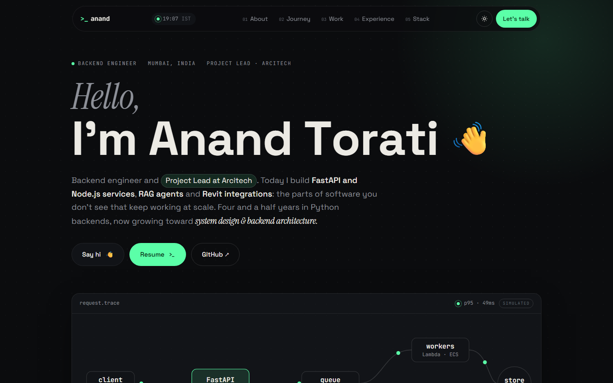
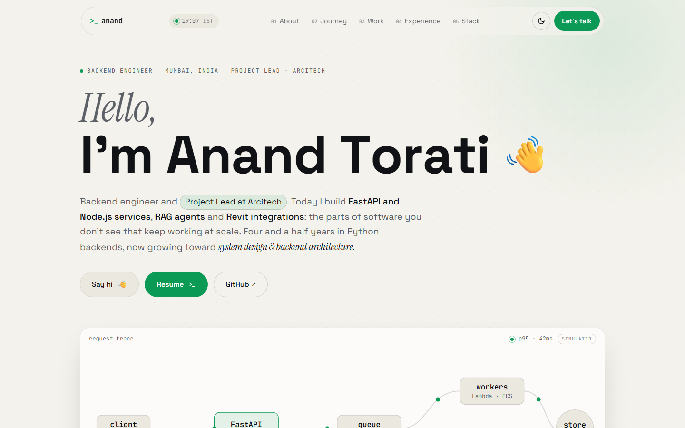
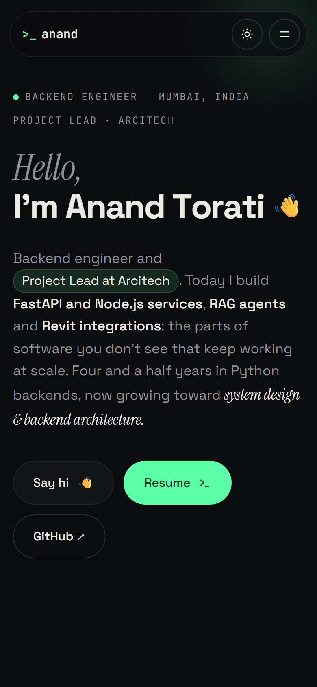

<div align="center">

# Anand Torati

**Backend Engineer · Project Lead at Arcitech**

FastAPI and Node.js services, RAG agents and Revit integrations, growing toward system design and backend architecture.

[](https://anandt9999.github.io/portfolio/)

[](https://github.com/anandT9999/portfolio/actions/workflows/deploy.yml)


<br />



</div>

## About

This is my personal portfolio. It tells the story of my work as a backend engineer, from writing my first REST endpoints to leading a team and designing systems, and it is built to feel like the kind of software I make: fast, quiet and well put together.

## Highlights

- **Resume as an API call.** The Resume button runs a `curl` request in a small terminal, streams the response headers, then hands over the PDF as a file card with a same-page download.
- **Live request-flow diagram.** The hero shows a request moving from the client through FastAPI, a queue and workers into the data stores.
- **The journey, level by level.** Six stages from endpoints to architecture, with a progress line that fills as you scroll.
- **Story, TL;DR or Timeline.** The About section lets visitors read my background in the format they prefer.
- **Smooth, light motion.** Framer Motion springs and scroll reveals, Lenis smooth scrolling, and no heavy blur effects, so it stays fast on ordinary laptops.
- **Dark and light themes**, a mobile layout and support for reduced-motion settings.

<table>
  <tr>
    <td width="68%"></td>
    <td width="32%"></td>
  </tr>
  <tr>
    <td align="center"><sub>Light theme</sub></td>
    <td align="center"><sub>Mobile</sub></td>
  </tr>
</table>

## Sections

| Section | What it shows |
| --- | --- |
| **Home** | Introduction, current focus, Resume terminal and the request-flow diagram |
| **About** | Background as a story, a TL;DR list or a timeline |
| **Journey** | Six levels of growth, from endpoints to system design |
| **Work** | Aufgang.ai: TB-scale file vectorisation into OpenSearch with Textract OCR and confidence filtering, AI agents, Revit / Autodesk integration, and 400+ FastAPI endpoints. Also BEAK, a database migration tool and selected repositories |
| **Experience** | Arcitech, Amunik and iLink Digital |
| **Stack** | Languages, databases, cloud, AI tools, certifications and education |
| **Contact** | Email, LinkedIn, GitHub and resume download |

## Built with

| Area | Tools |
| --- | --- |
| UI | React 18, Vite 5 |
| Motion | Framer Motion, Lenis |
| Styling | Plain CSS with theme tokens; Space Grotesk, Instrument Serif and JetBrains Mono |
| Hosting | GitHub Pages, deployed by GitHub Actions |

## Project structure

```
portfolio/
├── public/
│   └── Anand_Torati_Resume.pdf   # served for the Resume download
├── src/
│   ├── App.jsx                   # page sections and interactions
│   ├── motion.jsx                # reusable animation components
│   ├── data.js                   # all text content
│   ├── styles.css                # theme tokens and layout
│   └── main.jsx                  # entry point
├── docs/                         # README screenshots
└── .github/workflows/deploy.yml  # build and publish to GitHub Pages
```

## Run it locally

Requires Node.js 18 or newer.

```bash
git clone https://github.com/anandT9999/portfolio.git
cd portfolio
npm install
npm run dev
```

Then open http://localhost:8770. Run `npm run build` for a production build in `dist/`.

## Contact

- **Email:** anandtorati@gmail.com
- **LinkedIn:** [anand-torati9999](https://www.linkedin.com/in/anand-torati9999/)
- **GitHub:** [anandT9999](https://github.com/anandT9999)

<div align="center"><sub>Designed and built by Anand Torati.</sub></div>
